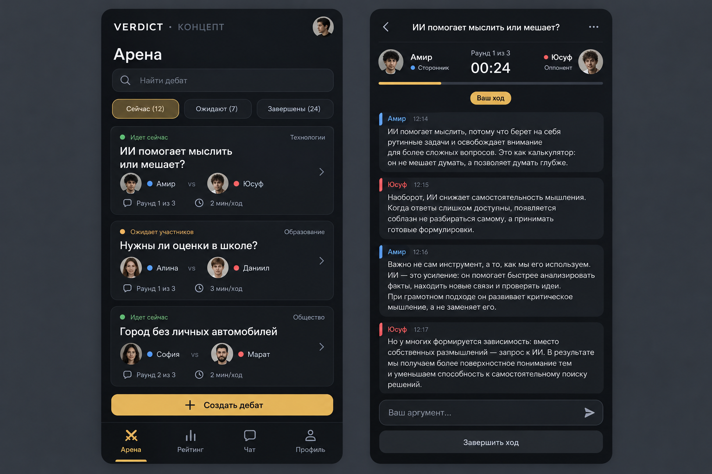

# VERDICT — направление обновления интерфейса

Статус: предложение дизайна, не внедрённый редизайн.
Цель: спокойная современная арена, где главный контент — аргументы, а не декор.
Сохранить Flutter/Firebase и проверенную механику. Переезд на Go/PostgreSQL для
косметического обновления не требуется.

## Визуальная система

- Основной фон #101114, панели #191B20, границы #2A2D34.
- Основной текст #F3F4F6, второстепенный #9CA3AF.
- Один золотой акцент #E6B85C для основного действия; без кислотно-жёлтых пузырей.
- Цвет бойца A #6D9EEB, бойца B #DB8290: тихие маркеры, не фон половины экрана.
- Удалить повторяющийся узор, свечение, тяжёлые градиенты и двойные рамки.
- Шрифт системный: 16–17 для сообщений, 20–24 для заголовков. Минимум ALL CAPS.
- Отступы по шкале 4/8/12/16/24/32, радиусы 12–16. Нажатия минимум 48dp.
- На планшете контент не растягивается от края до края: лента max 840dp,
  сообщения max 900dp с привычной шириной строки. Поддержка портрета и альбома.

## Главная

Верх: спокойный логотип VERDICT, профиль. Ниже короткий заголовок «Арена»,
поиск, компактные фильтры «Сейчас / Ожидают / Завершены». Язык и регион в
компактной панели фильтров вместо двух огромных выпадающих полей.

Карточка: небольшой статус → тема в 1–2 строки → имена и аватары участников →
количество раундов и время хода → одно главное действие.
Ожидающий создатель видит «Ожидание соперника» и вторичную «Отменить вызов».
Участник активного боя видит «Продолжить», зритель — «Смотреть».
Одна плавающая кнопка «Создать дебат», нижняя навигация из четырёх пунктов.
Пустая лента предлагает создать бой, ошибка чтения предлагает повторить запрос.

## Дебат-комната

Верх: назад, краткая тема, меню. Единственная панель боя: аватары, счёт,
«Раунд 1 из 3», имя активного бойца и один серверный таймер с тонкой полосой.
Убрать дублирующийся таймер и VS-карточку, оставив место сообщениям.

«Ваш ход» / «Ход оппонента» / «Вы зритель» — текстом и значком, не только цветом.
Сообщения на нейтральных панелях с тонким маркером стороны; длинные аргументы
читаются как текст. Внизу бойца — ввод и кнопка отправки, вторичная «Завершить ход».
После срока ввод блокируется. Для зрителя вместо неработающего ввода — панель
голосования с результатом собственного выбора.

Отправляемое сообщение появляется с понятным статусом. Pending не считается
доставленным; ошибка предлагает повторить, не создавая дубль. Медиа-загрузки
отдельно показывают прогресс и причину отказа.

## Создание и согласование

Короткая форма: тема → видимость → раунды/время → «Создать вызов».
Дополнительные язык/регион в раскрываемом разделе. Перед принятием соперник
видит итоговые условия. Ожидание, принятие и отмена различимы и подтверждаются
сервером. Разные предложения времени/раундов объясняются до старта.

## Результат

Немедленно показывать «Дебат завершён». Голоса зрителей — отдельный результат.
ИИ-оценка — отдельная необязательная секция с состояниями: не подключена,
ожидается, готова, недостаточно аргументов, ошибка. Не подменять ошибку ничьей
50/50 и не делать вид, что судья работал без настроенного ИИ.
Действия: «Повторить с тем же соперником», «На арену». Повторы и публичная
история добавляются после проверки приватности.

## Профиль

Имя, аватар, стабильный публичный ID; ниже статистика и история. Сначала
понятный аккаунт и сохранение входа. MMR и репутацию выводить после проверки
серверного начисления, не как случайные числа.
Переключение 1–6 — только тестовый инструмент; в production его нет.

## Приоритет обновлений

1. Закончить проверки сохранения профилей, голосования и запрета чужого хода.
2. Устранить ложную ИИ-ничью и объяснить состояние первого запроса World Chat.
3. Обновить главную и комнату как две согласованные поверхности, не все экраны
   сразу; сравнить читаемость на реальном планшете, в портрете и альбоме.
4. Привести создание, профиль и результат к той же системе компонентов.
5. Проверить контраст, увеличение шрифта, клавиатуру, медленную сеть,
   фоновый режим, длинные тексты и русский/арабский RTL.
6. Затем медиа, поиск и повторы. Видео и рейтинги — следующие этапы, не условие
   завершения текстового MVP.

Критерии: один главный призыв на экран; отправка/ошибки/права очевидны;
не дублируются таймеры; доступность без опоры только на цвет; интерфейс не
обещает работающий ИИ, медиа или рейтинг, пока соответствующая функция не готова.

## Визуальный концепт

Это сгенерированная иллюстрация направления, не скриншот работающего приложения.
Тексты, аватары и числа в ней — примеры. До внедрения нужно адаптировать макет
к планшету, проверить реальную длину сообщений, контраст и голосование зрителя.
